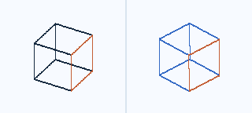
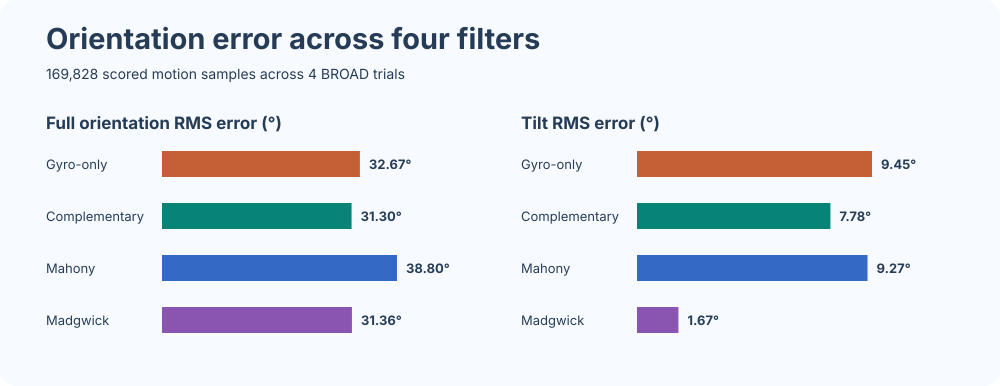

# AHRS Sensor-Fusion Benchmark

How much does an accelerometer help an attitude estimate, and what happens when the sensor gets bumped or starts vibrating?

This Python project compares three attitude filters (complementary, Mahony, and Madgwick) with a gyro-only baseline. It replays six public [BROAD](https://github.com/dlaidig/broad) IMU recordings offline and checks each estimate against optical motion capture.



*The first eight seconds of motion in trial 01. The orange face marks the sensor's +X axis.*

## What the data showed

On the four undisturbed runs, Madgwick brought tilt RMS error down from **9.45° to 1.67°** compared with gyro-only integration, an 82.4% reduction across 169,828 motion samples. The complementary filter had the lowest full-orientation RMS error at 31.30°. Tilt measures how far off the estimated vertical is. Full-orientation error also includes heading, which can drift when the only inputs are a gyro and accelerometer.

| Filter | Tilt RMS | Tilt max | Full orientation RMS | Full orientation max |
| --- | ---: | ---: | ---: | ---: |
| Gyro-only | 9.45° | 28.64° | 32.67° | 72.16° |
| Complementary | 7.78° | 77.49° | 31.30° | 87.13° |
| Mahony | 9.27° | 59.52° | 38.80° | 164.57° |
| Madgwick | 1.67° | 9.27° | 31.36° | 70.77° |



Fast translation was the toughest of the four runs for complementary and Mahony. The accelerometer picks up linear acceleration as well as gravity, so a fast translation can look like a change in tilt. During the first 25 seconds of rest in trial 01, Madgwick's tilt error grew at 0.16°/min versus 4.99°/min for gyro-only. Its full-orientation error still grew at 28.15°/min.

[Per-trial results and timings](results/per_trial.csv) · [Pooled results](results/pooled.csv) · [Roll, pitch, and yaw plots](results/tracking.svg) · [Drift plot](results/static_drift.svg)

## Bumps, vibration, and dropped samples

BROAD also has a trial where the researchers tapped the IMU and another where they attached a vibrating phone to the fixture. Across those two recordings (68,704 motion samples), Mahony had the lowest pooled tilt error. Complementary had the lowest tilt error on the phone trial alone. Both runs used the same gains as the four undisturbed runs.

| Filter | Tapping tilt RMS | Phone vibration tilt RMS | Pooled tilt RMS | Pooled full orientation RMS |
| --- | ---: | ---: | ---: | ---: |
| Gyro-only | 45.47° | 37.10° | 41.51° | 42.73° |
| Complementary | 1.26° | 1.66° | 1.47° | 8.75° |
| Mahony | 0.80° | 1.74° | 1.35° | 7.57° |
| Madgwick | 1.26° | 3.42° | 2.57° | 9.17° |

The rate test replayed the fast-rotation and phone-vibration recordings at 285.71, 142.86, and 71.43 Hz by keeping every sample, every second sample, or every fourth sample. All three replays were scored at the same optical timestamps. On fast rotation, Madgwick's tilt RMS was 1.04°, 0.81°, and 1.14° at those rates. The test drops samples without anti-alias filtering, so the results describe this replay setup.

One unit test simulates an IMU sitting still with a 0.5°/s gyro bias. After 60 seconds, Mahony's orientation error is below 0.05° with bias around a horizontal axis. The same bias around the vertical axis gives 30° of yaw drift.

[Disturbance results](results/stress_per_trial.csv) · [Pooled disturbance results](results/stress_pooled.csv) · [Sample-rate results](results/sample_rate_sweep.csv)

## Run it

Use Python 3.10 or newer. The six recordings are included.

```powershell
python -m venv .venv
.\.venv\Scripts\python.exe -m pip install -r requirements.txt
.\.venv\Scripts\python.exe benchmark.py
.\.venv\Scripts\python.exe stress_test.py
.\.venv\Scripts\python.exe -m unittest discover -s tests
```

If Windows opens the Microsoft Store, use `py -m venv .venv` for the first command. On macOS or Linux, use `.venv/bin/python` for the other commands.

The scripts write to `results/` by default. Use `--out my-results` to keep a separate run or `--download` to restore missing recordings. To run a different BROAD file, pass `--trial path/to/trial.hdf5` to `benchmark.py`. Repeat `--trial` for multiple files.

## How the benchmark works

Every filter starts at the first valid optical pose, including heading. From there it gets IMU samples at the recording's native rate (2000/7 Hz, about 286 Hz). The optical pose is used for scoring after initialization. Filters keep running through gaps in motion capture. The motion scores use samples that BROAD labels as moving and that have a valid reference. Pooled RMS is weighted by the number of scored samples.

The [filter code](ahrs/filters.py) uses Hamilton quaternions. Gyro-only integrates angular rate. Complementary nudges the estimate toward the accelerometer's vertical direction with a one-second time constant. Mahony uses gravity feedback and estimates gyro bias (`kp = 1.0`, `ki = 0.10`). Madgwick uses the gradient of the gravity error to correct the quaternion derivative (`beta = 0.035`). NumPy handles the metrics and transforms, and h5py reads the data.

Full-orientation error is the shortest angle between two orientations. Tilt error is the angle between their vertical directions in sensor coordinates. The drift rate is the slope of the error over up to 25 seconds of initial rest. The [timings](results/per_trial.csv) include Python iteration and result collection and use the median of three replays per filter on Windows. The [run configuration](results/run.json) records the gains and environment.

## References

- Laidig, Caruso, Cereatti, and Seel. [BROAD: A Benchmark for Robust Inertial Orientation Estimation](https://doi.org/10.3390/data6070072). [Dataset attribution and license](data/ATTRIBUTION.md).
- Madgwick. [An efficient orientation filter for inertial and inertial/magnetic sensor arrays](https://x-io.co.uk/downloads/madgwick_internal_report.pdf).
- Mahony, Hamel, and Pflimlin. [Nonlinear Complementary Filters on the Special Orthogonal Group](https://doi.org/10.1109/TAC.2008.923738).
